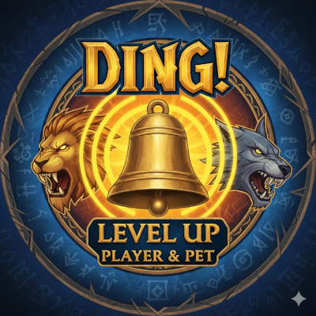

# Ding! Level Up

A lightweight, reliable World of Warcraft add-on that automatically announces level-up milestones for both **Players** and **Pets** to Guild Chat.

## Features

- **Player Dings:** Instantly announces your character's level-ups to guild chat.
- **Pet Dings:** Specifically designed for Hunters to announce when their active pets gain a level.
- **Smart Logic:** Uses a synchronization delay to ensure correct level reporting and GUID verification to prevent false announcements during pet swaps.
- **Guild Awareness:** Automatically falls back to a local system message if you aren't currently in a guild.
- **Customizable:** Color-coded feedback and intuitive slash commands.

---

## Installation

1. Download the latest release `.zip` for your specific game client version from the [Releases page](../../releases).
2. Extract the `Ding_Level_Up` folder.
3. Move the folder into your game installation directory:
   - **Classic Era / Forever:** `.../World of Warcraft/_forever_/Interface/AddOns/`
   - **TBC Anniversary:** `.../World of Warcraft/_classic_/Interface/AddOns/`
4. Restart your game client or reload your UI (`/reload`).

---

## Slash Commands

Use `/ding` to manage your settings in-game:

| Command | Action |
| :--- | :--- |
| `/ding player` | Toggle Player level-up announcements on/off |
| `/ding pet` | Toggle Pet level-up announcements on/off |
| `/ding test` | Simulate an announcement to verify it's working |
| `/ding` | Display the help menu |

---

## Technical Details

- **Events Handled:** `PLAYER_LEVEL_UP`, `UNIT_LEVEL`, `UNIT_PET`, `ADDON_LOADED`
- **Saved Variables:** `DingLevelUpSettings` (Per-Character configuration)

---

## Author

Built by **Frightware**.